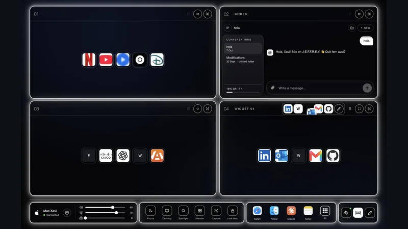
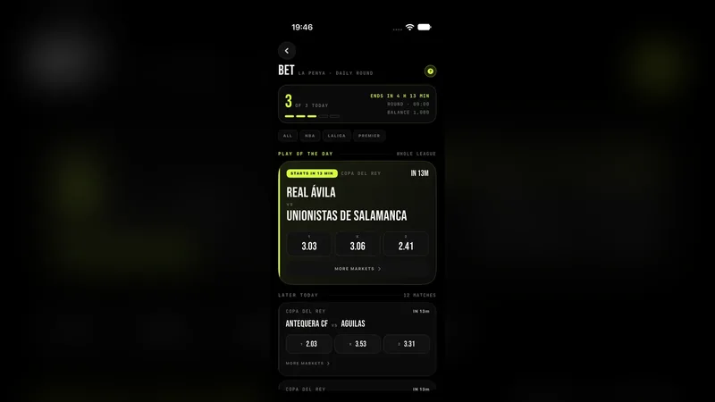
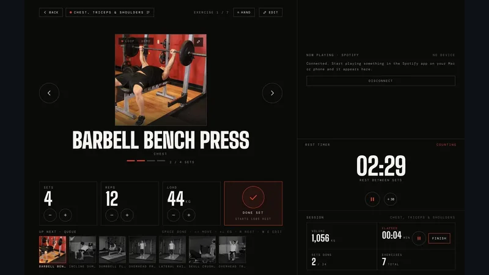
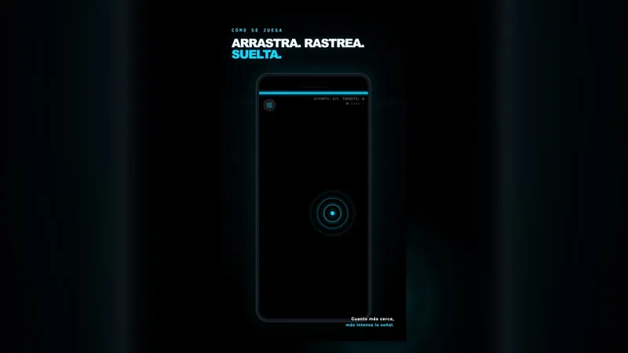
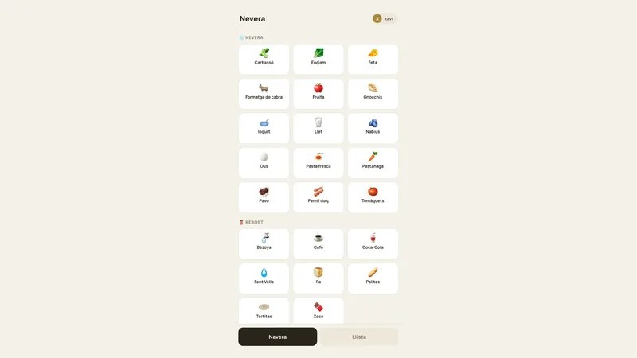
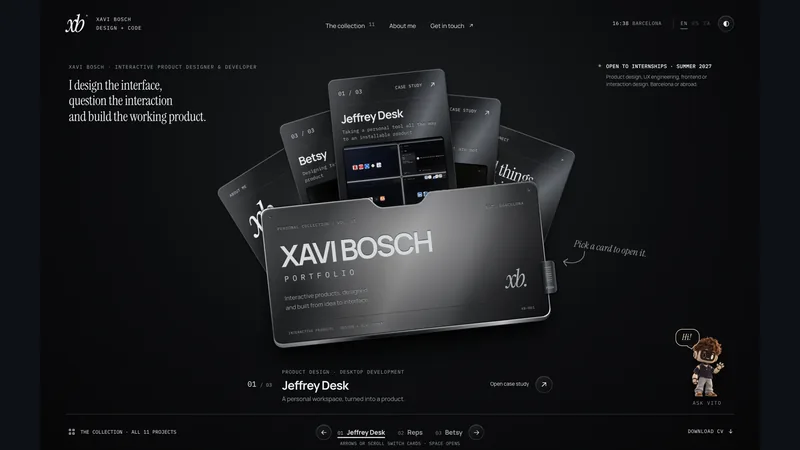

<picture>
  <source media="(prefers-color-scheme: dark)" srcset="./assets/header-dark.svg">
  
</picture>

  
  
  

  <b>CV</b> &nbsp;
  <a href="https://boschwebs.website/Xavi-Bosch-CV-EN.pdf">English</a> ·
  <a href="https://boschwebs.website/Xavi-Bosch-CV-ES.pdf">Español</a> ·
  <a href="https://boschwebs.website/Xavi-Bosch-CV-CA.pdf">Català</a>

## About

I'm a second-year Design and Creation of Interactive Products student at La Salle Barcelona. I work where product design, interaction and frontend meet: working out how something should behave, designing the interface, and building a version people can actually use.

Most of my projects start from a real frustration, mine or someone close to me. I prototype, test on real devices, and change the design when the implementation shows a better answer. I use AI to explore and build faster, and I check everything it gives me before it ships.

**Open to internships from June 2027, or through a university agreement**, in product design, UX engineering and frontend. Barcelona, abroad or remote.

## Selected work

<table>
<tr>
<td width="44%"></td>
<td>

### Jeffrey Desk
A Mac workspace that puts the web services, files, calendar and AI I use every day in one window, with an agent that can act on them.

**The decision:** one codebase, two editions. My daily desk and an installable product share the code, and a stranger's install starts empty instead of showing my life.

`Electron` `JavaScript` `Python` `whisper.cpp` 
[Case study](https://boschwebs.website/#/work/jeffrey-desk) · [jeffreydesk.com](https://jeffreydesk.com) · source private

</td>
</tr>
<tr>
<td></td>
<td>

### Betsy
Private sports leagues for friends, with virtual points and real results. Designed with the people it was for before the screens were drawn.

**The decision:** fairness lives in the database rules, not the UI. A payout can only happen once, and a duel rival's odds are never shown.

`SwiftUI` `Firebase` `Firestore rules` `Next.js` 
[Case study](https://boschwebs.website/#/work/betsy) · [Repository](https://github.com/xavibosch/betsy-ios)

</td>
</tr>
<tr>
<td></td>
<td>

### Reps
A training screen for a garage gym, controlled by pointing at the camera so chalked hands never touch it.

**The decision:** every control confirms on a hold, with a ring that fills first. One interaction contract for a hand, a mouse or a touch screen, and no swipe, because a swipe and a moving cursor are the same gesture.

`React` `TypeScript` `MediaPipe` `Electron` 
[Case study](https://boschwebs.website/#/work/reps) · [Repository](https://github.com/xavibosch/reps) · [Web](https://home-gym-nine.vercel.app)

</td>
</tr>
<tr>
<td></td>
<td>

### Haptic Hunter
An iOS game you play through vibration and sound, built so blind, deaf and low-vision players get the same game.

**The lesson:** a vibration is a line in a log on the simulator. The patterns I liked there were the ones you could not tell apart in your hand, so every tuning pass happened on a real phone.

`Swift` `Core Haptics` `Spatial audio` 
[Repository](https://github.com/xavibosch/haptic-hunter)

</td>
</tr>
<tr>
<td></td>
<td>

### Nevera Bosch
My family's shopping list. Tapping an NFC tag on the fridge opens it, with no install and no account, and it syncs live between every phone.

**In daily use** at home, which is the test that matters for something this small.

`React` `Vite` `Firebase` `PWA` `NFC` 
[Repository](https://github.com/xavibosch/nevera-bosch)

</td>
</tr>
<tr>
<td></td>
<td>

### Portfolio
A silver cardholder you open, three full case studies where every claim is tagged by how sure it is, and Vito, an assistant that answers only from what the site says.

`Vite` `GSAP` `CSS 3D` `Vercel functions` `EN / ES / CA` 
[boschwebs.website](https://boschwebs.website) · [Repository](https://github.com/xavibosch/portfolio)

</td>
</tr>
</table>

Also: [Gesture TV](https://github.com/xavibosch/gesture-tv), which replaces a TV remote for someone who cannot use one, offline and private. [Jeffrey](https://github.com/xavibosch/jeffrey-ai-assistant), [Jeffrey Remote](https://github.com/xavibosch/jeffrey-remote) and [Wake Station](https://github.com/xavibosch/jeffrey-wake-station), the voice agent, phone remote and Arduino trigger that came before Jeffrey Desk.

## How I work

- **Start from a real frustration**, compare a few ways to solve it, build the one that holds up, and write down what is still a guess.
- **Test on the real thing.** Real devices, real data, real people where I can get them. Simulators and mockups hide the problems that matter.
- **Take it apart before touching it.** When something breaks I isolate each piece first. It is faster than guessing.

## Tools

<picture>
  <source media="(prefers-color-scheme: dark)" srcset="./assets/skills-dark.svg">
  
</picture>

## Activity

<table>
  <tr>
    <td valign="top"></td>
    <td valign="top"></td>
  </tr>
</table>

Header, tools, heatmap and portrait are animated SVG drawn by the scripts in this repository. The heatmap refreshes daily.

