### Xavi Bosch

I design the interface, question the interaction and build the working product. 
Second-year Interactive Product Design and Creation student at La Salle Barcelona. 
Open to internships from summer 2027, in Barcelona or abroad.

**[boschwebs.website](https://boschwebs.website)** · [LinkedIn](https://www.linkedin.com/in/xavier-bosch-galilea-9b3876410) · bosch.xavii@gmail.com

| Project | What it is | What it shows |
| --- | --- | --- |
| **Jeffrey Desk** | A Mac workspace with an AI agent that can act on your pages and files. Product at [jeffreydesk.com](https://jeffreydesk.com), source private | Taking a personal tool to something a stranger can install |
| [**Betsy**](https://github.com/xavibosch/betsy-ios) | Private sports leagues with virtual points, SwiftUI + Firebase | Research with the people it was for, and fairness enforced in the database rules |
| [**Reps**](https://github.com/xavibosch/reps) | A gym screen you control by pointing at the camera, React + MediaPipe | One interaction contract (hold to confirm) for hands that are not free |
| [**Gesture TV**](https://github.com/xavibosch/gesture-tv) | Replaces a TV remote for someone who cannot use one | Designing for one real person, offline and private |
| [**Haptic Hunter**](https://github.com/xavibosch/haptic-hunter) | An iOS game played through vibration and sound | Accessibility as a property of the whole system |
| [**Portfolio**](https://github.com/xavibosch/portfolio) | The cardholder, in EN/ES/CA, with an assistant that answers from the site | Case studies that say what is proven and what is not |

<h3><code>xavi@github ~ $ ./contributions.sh</code></h3>

  

<h3><code>xavi@github ~ $ whoami</code></h3>

<table>
  <tr>
    <td valign="top"></td>
    <td valign="top"></td>
  </tr>
</table>

 

All motion is self-contained animated SVG — no third-party stats services, no token, no JavaScript. The heatmap refreshes daily via GitHub Actions.

